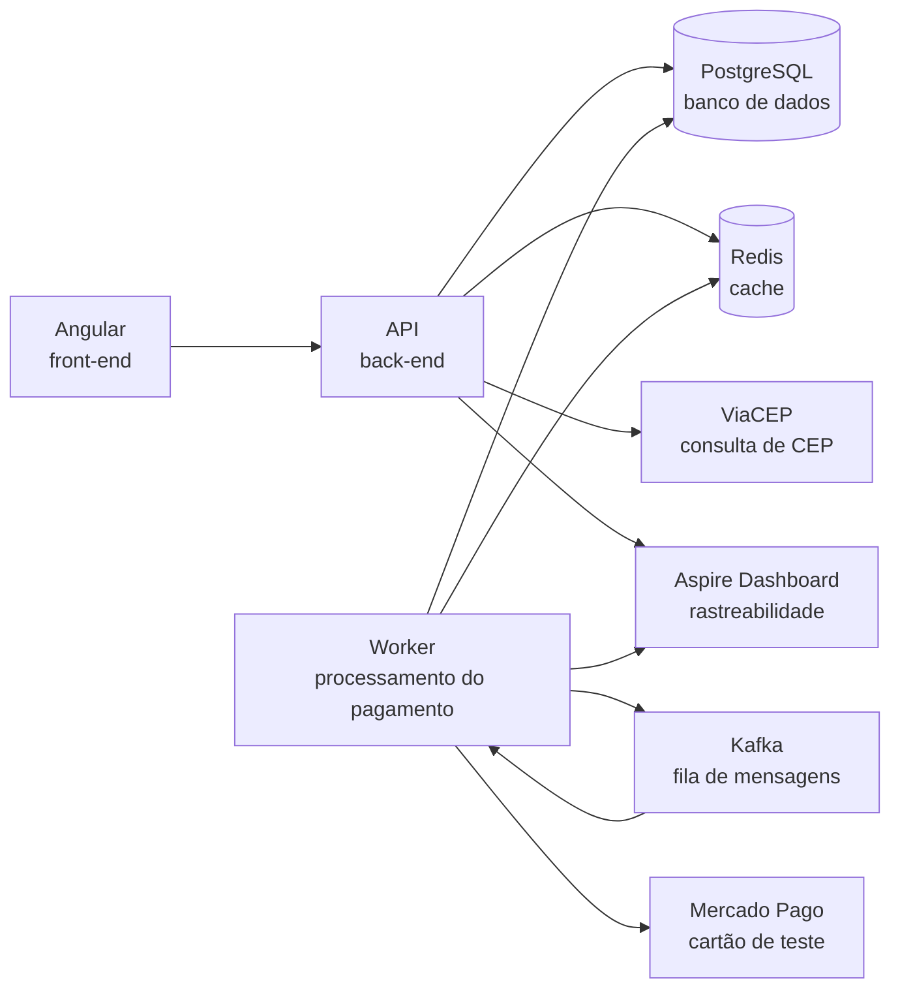

# PlataformaPedidos.Backend

Pedidos nascem com o status **Rascunho**. O usuário informa o CEP, o número e os itens. A API busca o endereço no ViaCEP, guarda o pedido no PostgreSQL e devolve esse rascunho para a tela.

Pedir o pagamento não confirma na hora. O status passa para **Aguardando pagamento** e uma mensagem fica gravada junto com o pedido, na tabela `mensagens_outbox`. A tela continua consultando até o status mudar.

O worker lê essa tabela e publica a mensagem no Kafka. Depois ele mesmo consome `pedidos.pagamento-solicitado` e cobra o cartão no Mercado Pago, em modo de teste. Se o pagamento for aprovado, o pedido fica **Confirmado**. Se for recusado, fica **Cancelado**, com o motivo. Se a mesma mensagem chegar de novo, o worker reconhece o identificador e não cobra outra vez. Um pedido que ainda não foi confirmado também pode ser cancelado, com um motivo.

O front-end que mostra essa história está no repositório `PlataformaPedidos.Frontend`. O porquê da outbox, do Redis e da idempotência está em `docs/adr/`.



1. O usuário preenche o CEP e os demais dados e clica em criar pedido.
2. A API consulta o CEP no ViaCEP, registra no PostgreSQL com status **Rascunho** e guarda o endereço no Redis.
3. O usuário informa o cartão na tela. O navegador pede um token ao Mercado Pago e a API não recebe o número do cartão.
4. A API muda o status para **Aguardando pagamento** e guarda a mensagem, com o token, no PostgreSQL.
5. O worker lê essa mensagem e publica no Kafka.
6. O Kafka devolve a mensagem ao worker.
7. O worker cria o pagamento no Mercado Pago. Aprovado, o pedido segue. Recusado, o pedido é cancelado.
8. O worker grava no PostgreSQL o status **Confirmado**.
9. A tela consulta de novo e mostra **Confirmado**. O Aspire Dashboard mostra o rastro dessa passagem.

## Subir na sua máquina

Abra um terminal na pasta deste repositório. A API e o worker precisam cada um do seu terminal, e os dois ficam abertos enquanto você testa.

1. Subir a infraestrutura (banco de dados PostgreSQL, Redis, Kafka e painel de observabilidade).

```powershell
docker compose up -d
```

2. Atualizar o banco de dados. O comando aplica a migration do projeto e deixa as tabelas prontas.

```powershell
dotnet ef database update --project backend/src/PlataformaPedidos.Infraestrutura/PlataformaPedidos.Infraestrutura.csproj
```

3. Subir a API. Deixe este terminal aberto.

```powershell
dotnet run --project backend/src/PlataformaPedidos.Api --launch-profile http
```

4. Subir o worker, em outro terminal. Deixe este terminal aberto.

```powershell
dotnet run --project backend/src/PlataformaPedidos.Worker
```

Sem o worker, o pedido para em **Aguardando pagamento**. Sem as credenciais de teste do Mercado Pago, o pedido também para aí: a cobrança não tem como ser autorizada.

| O que | Para quê | Onde |
|---|---|---|
| API em ASP.NET Core | Recebe o pedido, o pagamento e o cancelamento | http://localhost:5081 |
| Scalar | Documentação da API e endpoints | http://localhost:5081/scalar |
| Health check | Diz se PostgreSQL, Redis e Kafka estão respondendo | http://localhost:5081/health |
| PostgreSQL | Guarda o pedido, a outbox e as mensagens já processadas | localhost:5432, banco `plataforma_pedidos`, usuário e senha `plataforma` |
| Redis | Guarda a consulta de CEP e a consulta do pedido | localhost:6379 |
| Kafka | Leva a mensagem do pedido até o worker | localhost:9092 |
| ViaCEP | Devolve o endereço de um CEP real. Gratuito e sem chave | https://viacep.com.br |
| Mercado Pago | Cobra o cartão de teste. A Public Key fica no navegador e o Access Token fica só na API e no worker | https://api.mercadopago.com |
| Aspire Dashboard | Mostra os rastros das chamadas da API e do worker | http://localhost:18888 |
| Angular | Tela para criar o pedido e acompanhar o status | http://localhost:4200 |

O endereço sai do ViaCEP. Qualquer CEP existente funciona, e um número inexistente volta como não encontrado.

## Credenciais de teste

O cartão é digitado na tela, então a aplicação no Mercado Pago precisa ser **Checkout Transparente**, no ambiente de teste. Cada pessoa cria a sua no [Mercado Pago Developers](https://www.mercadopago.com.br/developers/panel/app). A Public Key e o Access Token não entram no Git.

1. Copiar a Public Key e o Access Token de teste dessa aplicação.

2. Na raiz deste repositório, criar o arquivo local a partir do exemplo.

```powershell
Copy-Item mercadopago.local.exemplo.json mercadopago.local.json
```

3. Abrir `mercadopago.local.json` e trocar os dois textos pelas credenciais. A API e o worker leem esse arquivo quando sobem. Se eles já estiverem abertos, feche e suba de novo.

A Public Key aparece na tela. O Access Token fica só nesse arquivo. Ele está no `.gitignore`.

Na tela de cartão, um teste que aprova usa o Visa `4235 6477 2802 5682`, validade `11/30`, código `123`, titular `APRO` e CPF `12345678909`. O que você escreve no titular muda o resultado: `APRO` aprova o pagamento, `OTHE` recusa o cartão e `FUND` recusa porque o limite é insuficiente. No e-mail, use qualquer endereço válido, menos o da conta do Mercado Pago. Nenhum desses números cobra de verdade.

## Testes

```powershell
dotnet test backend/PlataformaPedidos.sln
```

Os testes de integração sobem PostgreSQL, Redis, Kafka e WireMock pelo Testcontainers. O Docker precisa estar em execução.
